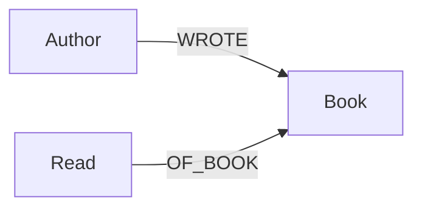
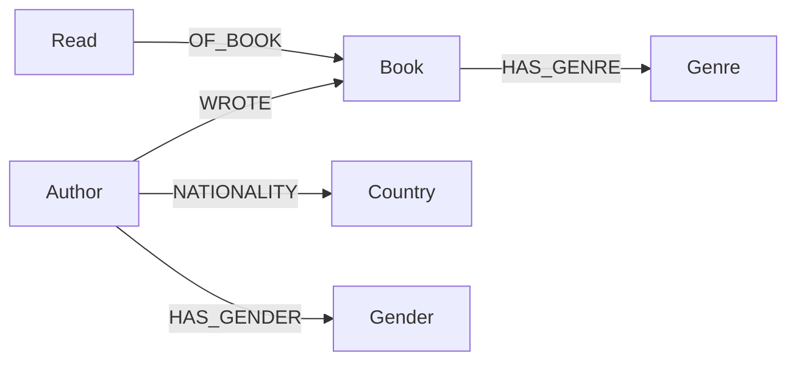

# Books KG

A personal knowledge graph of the books I've read, built in Neo4j, to answer
questions a flat spreadsheet can't - author patterns, seasonal reading habits,
what I was reading at the same time as a given book, and whether my reading 
skews toward particular genders, nationalities, or genres.

## Goals

- Track what I read and when (title, author, date finished, score).
- Answer relational questions:
  - Which authors have I read more than 3 books from, and how does their
    average score compare to my overall average?
  - Do I score books higher in certain months or seasons?
  - What else was I reading around the same time as book X?
  - Which authors are similar to the ones I score highest?
- Enrich the graph later with genre, book summary, and author
  gender/nationality (e.g. via Wikidata) to check for reading biases and
  support recommendations.

## Schema (v1 - core)



**Nodes**
| Label    | Properties                                             |
|----------|--------------------------------------------------------|
| `Author` | `name`                                                 |
| `Book`   | `title`                                                |
| `Read`   | `date` (Neo4j Date, day defaults to 01), `score` (int) |

`Read` is a separate node (not just a relationship property) because it
represents a reading *event* - this keeps the door open for re-reads later
even though we're not modeling them for now, and it's the natural place to
hang the date + score without cluttering `Book`.

There is no `User/"me"` node - this graph is single-reader, so it's implicit.

## Schema (v2 - enrichment, added later)



Additional properties: `Book.summary`, `Book.publication_year`. Gender,
nationality, and genre are all modeled as nodes rather than properties,
since all three are things you'll want to group/aggregate by for the
bias check. See `schema/schema.md` for the full reasoning.

## Project structure

```
books_kg/
├── .env.example
├── .gitignore
├── .python-version
├── pyproject.toml
├── uv.lock
├── README.md
├── data/
│   └── raw/
│       ├── .gitkeep
│       └── books_raw_<date>.csv
├── docs/
│   └── .gitkeep
├── notebooks/
│   └── .gitkeep
├── schema/
│   ├── constraints.cypher
│   └── schema.md
└── src/
    ├── enrich/
    │   └── wikidata_enrich.py
    ├── ingest/
    │   └── load_books.py
    └── queries/
        └── analytics.cypher
```

## Setup

### 1. Start Neo4j

For a local database, install [Neo4j Desktop](https://neo4j.com/download/), create
an instance, and start it. Opening Desktop does not necessarily start the
database instance. When creating the instance, choose a database username and
password. A Neo4j website sign-in, if Desktop asks for one, is separate from
these database credentials. A local Desktop database does not require an Aura
cloud database.

Find the Bolt connection URI in the instance's **Overview** (commonly
`bolt://localhost:7687`) and note the database credentials. Use the same
instance and database when applying constraints, loading data, and running
queries. The default database is usually `neo4j`.

### 2. Set up Python and credentials

Install [uv](https://docs.astral.sh/uv/getting-started/installation/) if needed.
On Windows, you can install it from PowerShell:

```powershell
powershell -ExecutionPolicy ByPass -c "irm https://astral.sh/uv/install.ps1 | iex"
```

From the project root, sync dependencies:

```powershell
uv sync
```

Copy `.env.example` to `.env` and enter the local instance's connection URI,
username, and password:

```powershell
Copy-Item .env.example .env
```

Never commit `.env` or share its password. `NEO4J_DB_NAME` is present in the
example file, but the current loader does not use it; it connects to Neo4j's
default database.

### 3. Apply schema constraints

In Neo4j Desktop, make sure the instance is running, then choose **Connect →
Query** on its card and select the default database (usually `neo4j`). 
On VS Code, open `schema/constraints.cypher`, select and copy each `CREATE CONSTRAINT` statement through its semicolon.
Back in Neo4j Desktop Query, paste and run one `CREATE CONSTRAIN` statement at a time.
The `//` lines are comments and don’t need to be run.

You can also run the whole file with `cypher-shell` from the project root:

```powershell
cypher-shell -a bolt://localhost:7687 -u neo4j -d neo4j -f schema/constraints.cypher
```

Use your instance's Bolt URI, username, and target database if they differ.
Omitting `-p` lets Cypher Shell prompt for the password instead of putting it
in the command or shell history. If `cypher-shell` is not on `PATH`, run it
from the Neo4j installation's `bin` directory or use the Desktop Query tool.
The statements use `IF NOT EXISTS`, so rerunning them is safe. To check them,
run:

```cypher
SHOW CONSTRAINTS;
```

### 4. Prepare and load the CSV

Export your data to CSV with these exact column headers:
`title, author, year_month, score`. Use `YYYY_MM` for `year_month` (for example,
`2006_02`) and a numeric score. The loader converts that month to the first day
of the month for Neo4j's date value.

Save the file in `data/raw/`, for example as
`data/raw/books_raw_20261001.csv`. From the project root, pass its filename to
the loader:

```powershell
uv run python src/ingest/load_books.py books_raw_20261001.csv
```

The filename argument is just the filename, not the `data/raw/` path. If
omitted, the loader uses `data/raw/books.csv`. With an already activated
environment, you can use `python` instead of `uv run python`.

The loader creates a new `Read` node per CSV row. Run it only once for a given
dataset unless you intend to add those reading events again. Each row is sent
as its own query, so if a load fails partway through, earlier rows may already
be in the database. Check the database before retrying to avoid duplicate
reading events:

```cypher
MATCH (r:Read) RETURN count(r) AS reads;
```

### 5. Explore the data

Open the Query tool for the same instance and database. Run queries from
`src/queries/analytics.cypher` one at a time. Queries 1 and 2 need no input.
Query 3 uses the `$title` parameter; set it in your query tool (for example,
`Dune`) or replace `$title` with a title from your data. Query 4 requires the
Phase 2 genre nodes and relationships, so it will not return results until
genre enrichment has been added.

To visualize the graph, run a query that returns a path, then choose the
**Graph** results view:

```cypher
MATCH p = (a:Author)-[:WROTE]->(b:Book)<-[:OF_BOOK]-(r:Read)
RETURN p
LIMIT 25;
```

Increase or remove the limit to display more of the graph.

## Roadmap

- [x] Phase 1: core schema - Author, Book, Read
- [x] Phase 1: ingest script, constraints, and initial data load
- [x] Phase 1: verify core analytics queries 1-3 end-to-end
- [ ] Phase 2: enrich with genre, summary, author gender/nationality
      (Wikidata / Open Library / Google Books)
- [ ] Phase 2: author similarity using shared genres (query 4)
- [ ] Phase 2: bias check - distribution of reads/scores by author gender
      and nationality
- [ ] Phase 3: recommendations using Neo4j Graph Data Science (for example,
  node similarity or a co-read graph)
