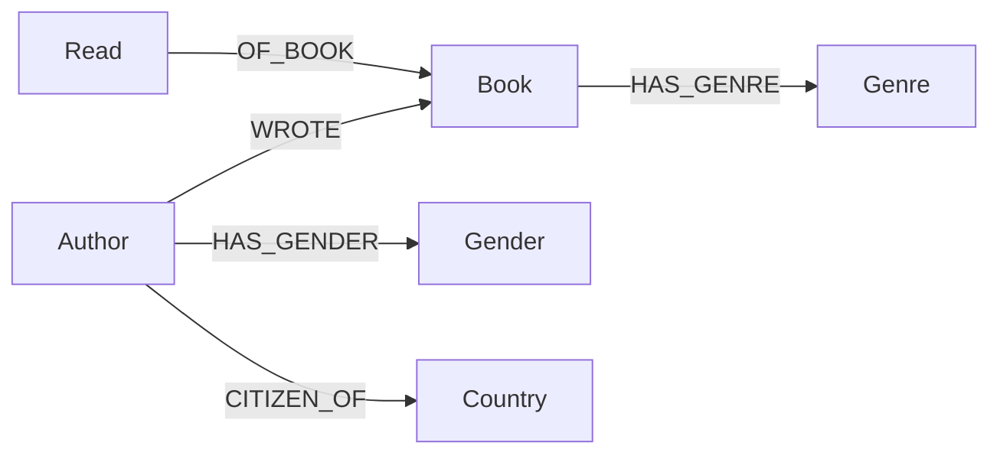

# Books KG

A personal Neo4j knowledge graph of books read, reading dates and scores, authors, genres, and selected author attributes.

## Data model



`Book.book_id` is the stable source identity; `Book.title` is the canonical title. Each book has one `Read` node keyed by the same ID, storing the reading date, score, `title_read`, and `language_read`. The complete model and provenance rules are in [schema/schema.md](schema/schema.md).

## Setup

1. Install [Neo4j Desktop](https://neo4j.com/download/) and create and start a local DBMS. Use the `neo4j` database.
2. Install [uv](https://docs.astral.sh/uv/getting-started/installation/). On Windows, use PowerShell:

    ```powershell
    winget install --id=astral-sh.uv -e
    uv sync
    Copy-Item .env.example .env
    ```

3. Configure `NEO4J_URI`, `NEO4J_USER`, `NEO4J_PASSWORD`, `NEO4J_DB_NAME`, and `BOOKS_CSV_PATH` in `.env`.
4. Apply `schema/constraints.cypher` once using Neo4j Desktop's **Query** tool.

## Cumulative CSV

Maintain one append-only CSV selected by `BOOKS_CSV_PATH`. Its headers are:

```text
book_id,title,title_read,language_read,author,year_month,score
```

Keep `book_id` stable and unique, including leading zeros. Each book appears once. Use `YYYY_MM` for `year_month`; the day is set to `01`. Scores must be finite numbers and may be decimal. Separate authors with `/`; the loader trims each name and creates a separate author relationship. `title_read` and `language_read` are required and must be nonblank; surrounding whitespace is trimmed. They are stored on `Read`, while `Book.title` remains the canonical title.

Escape literal quotes inside quoted CSV fields by doubling them (`""`). The loader rejects malformed quoting and reports its line number.

The loader validates the entire CSV before connecting to Neo4j. From the project root, run:

```powershell
uv run python src/ingest/load_books.py
```

Books and Reads are merged by `book_id`; Authors and relationships are merged. Re-running the full cumulative file is safe and reports inserted, updated, and unchanged rows. Do not reuse a book ID for a different book.

## Wikidata enrichment

Run after ingestion:

```powershell
uv run python src/enrich/wikidata_enrich.py
```

Wikidata automatically accepts unique exact-label candidates after entity validation; book matches also check known authors. The normal run processes new, unresolved, and stale records. `--interactive` prompts for review candidates; `--refresh` updates facts for stored Wikidata IDs but does not rematch. Open Library summaries have independent status and refresh behavior. The [user guide](docs/user-guide.md) is the canonical reference for statuses, report replay, targeted filters, manual QIDs, rematches, and resets. `WIKIDATA_USER_AGENT` can be set in `.env`.

## Rerun order

After the initial setup, for each update to the cumulative CSV:

1. Run `uv run python src/ingest/load_books.py`.
2. Run `uv run python src/enrich/wikidata_enrich.py` and review `data/reports/`.
3. Run the desired queries from `src/queries/analytics.cypher`.

Query 3 takes `$book_id`; query 4 requires genre data. Gender and citizenship analytics include only classified authors; a multi-author book may contribute to multiple categories.

To visualize the graph in Neo4j Browser, run a query that returns a path:

```cypher
MATCH p = (a:Author)-[:WROTE]->(b:Book)<-[:OF_BOOK]-(r:Read)
RETURN p
LIMIT 25;
```

For language counts and reading-title comparisons, run queries 7 and 8 in
`src/queries/analytics.cypher`.

## Roadmap

- [x] Phase 1: core graph schema, cumulative CSV ingestion, and reading analytics
- [x] Phase 2: idempotent ingestion, Wikidata/Open Library enrichment, genre overlap, and gender/citizenship analytics
- [ ] Phase 3: personalized recommendations using Neo4j Graph Data Science
