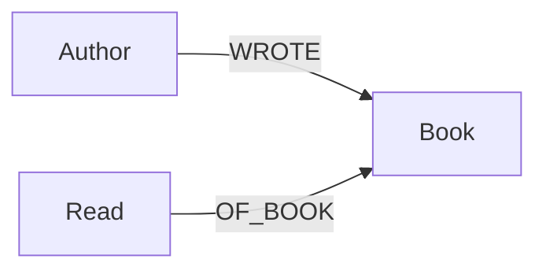
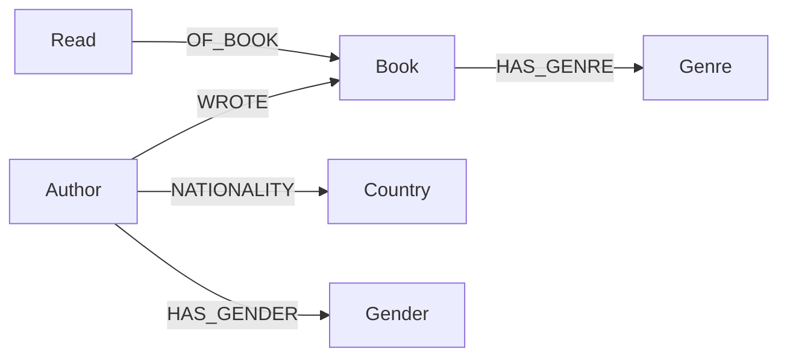

# Books KG

A personal knowledge graph of the books I've read, built in Neo4j, to answer
questions a flat spreadsheet can't - author patterns, seasonal reading habits,
what I was reading at the same time as a given book, and whether my reading 
skews toward particular genders, nationalities, or genres.

## Goals

- Track what I read and when (title, author, date finished, score).
- Answer relational questions:
  - Which authors have I read more than 3 books from, and how does their
    average score compare to my overall average?
  - Do I score books higher in certain months or seasons?
  - What else was I reading around the same time as book X?
  - Which authors are similar to the ones I score highest?
- Enrich the graph later with genre, book summary, and author
  gender/nationality (e.g. via Wikidata) to check for reading biases and
  support recommendations.

## Schema (v1 - core)



**Nodes**
| Label    | Properties                                             |
|----------|--------------------------------------------------------|
| `Author` | `name`                                                 |
| `Book`   | `title`                                                |
| `Read`   | `date` (Neo4j Date, day defaults to 01), `score` (int) |

`Read` is a separate node (not just a relationship property) because it
represents a reading *event* - this keeps the door open for re-reads later
even though we're not modeling them for now, and it's the natural place to
hang the date + score without cluttering `Book`.

There is no `User`/"me" node - this graph is single-reader, so it's implicit.

## Schema (v2 - enrichment, added later)



Additional properties: `Book.summary`, `Book.publication_year`. Gender,
nationality, and genre are all modeled as nodes rather than properties,
since all three are things you'll want to group/aggregate by for the
bias check. See `schema/schema.md` for the full reasoning.

## Project structure

```
books_kg/
├── .env.example
├── .gitignore
├── .python-version
├── pyproject.toml
├── uv.lock
├── README.md
├── data/
│   └── raw/
│       ├── .gitkeep
│       └── books_raw_<date>.csv
├── docs/
│   └── .gitkeep
├── notebooks/
│   └── .gitkeep
├── schema/
│   ├── constraints.cypher
│   └── schema.md
└── src/
    ├── enrich/
    │   └── wikidata_enrich.py
    ├── ingest/
    │   └── load_books.py
    └── queries/
        └── analytics.cypher
```

## Setup

1. **Get Neo4j running** - easiest is [Neo4j Desktop](https://neo4j.com/download/)
   or a free [AuraDB Free](https://neo4j.com/cloud/aura-free/) instance. Note
   the connection URI, username, and password.

2. **Python environment** 
   
   - install [uv](https://docs.astral.sh/uv/getting-started/installation/), 
   
   ```powershell
   powershell -ExecutionPolicy ByPass -c "irm https://astral.sh/uv/install.ps1 | iex"
   ```

   - then sync the project dependencies:

   ```bash
   uv sync
   ```

3. **Credentials** - copy `.env.example` to `.env` and fill in your Neo4j
   connection details (never commit `.env`).

4. **Apply constraints**

   Open Neo4j Browser (or `cypher-shell`) and run the contents of
   `schema/constraints.cypher`.

5. **Export your data** from Access to CSV with columns
   `title, author, year_month, score`, save it to `data/raw/books_raw_<date>.csv`.

6. **Load it**

   ```bash
   uv run python src/ingest/load_books.py
   ```

7. **Explore** - open Neo4j Browser and try the queries in
   `src/queries/analytics.cypher`, or run them from Python/a notebook.

## Roadmap

- [x] Phase 1: core schema - Author, Book, Read
- [ ] Phase 1: ingest script + constraints
- [ ] Phase 1: four analytics queries working end-to-end
- [ ] Phase 2: enrich with genre, summary, author gender/nationality
      (Wikidata / Open Library / Google Books)
- [ ] Phase 2: bias check - distribution of reads/scores by author gender
      and nationality
- [ ] Phase 3: similarity & recommendations (Neo4j Graph Data Science -
      node similarity over shared genres, or a co-read graph)
