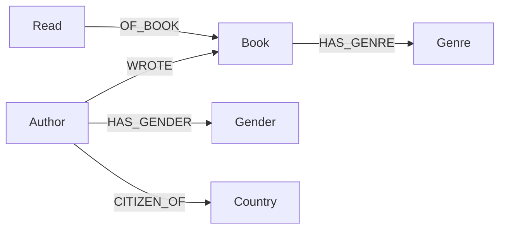

# Books KG

A personal Neo4j knowledge graph of books read, reading dates and scores, authors,
genres, and selected author attributes.

## Data model



`Book.book_id` is the stable source identity; `title` is display data. Each
book has one `Read` node keyed by the same ID. `Read.score` supports decimals.
The complete model and provenance rules are in [schema/schema.md](schema/schema.md).

## Setup

1. Start a local Neo4j database and note its Bolt URI and credentials.
2. Install [uv](https://docs.astral.sh/uv/getting-started/installation/) and run:

   ```powershell
   uv sync
   Copy-Item .env.example .env
   ```

3. Set `NEO4J_URI`, `NEO4J_USER`, `NEO4J_PASSWORD`, and `NEO4J_DB_NAME` in `.env`.
   Never commit `.env` or share its password.
4. Apply `schema/constraints.cypher` to the same database. The statements are
   safe to rerun. They replace the old title uniqueness constraint with stable
   Book and Read ID constraints. External IDs are references and may be shared
   by multiple local records.

For example, from PowerShell:

```powershell
cypher-shell -a bolt://localhost:7687 -u neo4j -d neo4j -f schema/constraints.cypher
```

Omitting `-p` lets Cypher Shell prompt for the password. Start with a fresh
database and apply the constraints before the first CSV load.

## Cumulative CSV

Maintain one append-only file at `data/raw/books_raw_20261001.csv` with these
headers:

```text
book_id,title,title_read,language_read,author,year_month,score
```

Keep `book_id` stable and unique, including leading zeros. Each book appears
once. Use `YYYY_MM` for `year_month`; the day is set to `01`. Scores must be
finite numbers and may be decimal. Separate authors with `/`; the loader trims
each name and creates a separate author relationship. `title_read` and
`language_read` are retained in the source CSV but are not currently imported
into Neo4j; ingestion uses `book_id`, `title`, `author`, `year_month`, and
`score`.

The loader validates the entire CSV before connecting to Neo4j. From the
project root, run:

```powershell
uv run python src/ingest/load_books.py
```

Books and Reads are merged by `book_id`; Authors and relationships are merged.
Re-running the full cumulative file is safe and reports inserted, updated, and
unchanged rows. Do not reuse a book ID for a different book.

## Wikidata enrichment

Run after ingestion:

```powershell
uv run python src/enrich/wikidata_enrich.py
```

Wikidata is primary. Authors are automatically matched only when exactly one
candidate has the same normalized English label and is verified as a human.
When there is no unique exact human match but one or more verified human
candidates exist, the author is reported as `needs_review`; `no_candidate`
means the attempted search returned no verified human candidates, not that the
author is absent from Wikidata. Search results are limited and ranked, so they
cannot prove absence. Non-human results are excluded from author candidates.
For books, automatic matching likewise requires one exact normalized English
label and the existing book type check. When known authors have Wikidata IDs,
candidates with conflicting `P50` author claims are excluded; candidates with
no `P50` claims or at least one matching author remain eligible. Books with
suitable candidates but no unique exact match are `needs_review`; `no_candidate`
means the search found no candidates passing these checks. This does not prove
that the work is absent from Wikidata. Review reports include suitable
candidate IDs, labels, descriptions, English aliases, and book author IDs when
available.

Use `--interactive` to choose a numbered candidate for each author or book
needing review; press Enter to skip. Author choices are revalidated as humans,
and book choices are revalidated against the book type and known-author checks,
before their IDs are stored. Skipped choices remain in the timestamped CSV under
`data/reports/` for later review. Without `--interactive`, enrichment remains
non-interactive and still writes the report. Stored accepted Wikidata IDs are
reused on future runs. New and unresolved entities are checked each run;
accepted matches are refreshed after 180 days. Use `--refresh` to recheck all
records or `--limit 5` for a small trial. Each HTTP request waits a randomized
5–10 second base interval plus 0.42–1.42 seconds of positive jitter. Adjust the bounds with
`--request-interval-min`, `--request-interval-max`, `--jitter-min`, and
`--jitter-max`. The script prints queue sizes and progress after each entity.
`WIKIDATA_USER_AGENT` can be set in `.env`.

Lookup errors do not erase stored facts. Gender and genre remain nodes. Wikidata
P27 is modeled as `CITIZEN_OF`, not assumed to mean nationality. Open Library
summary lookup remains separate from Wikidata book matching: it is used only
when no summary exists and a unique exact title-and-author work match is found.
Summary source is recorded; Wikidata descriptions are not treated as book
summaries.

## Rerun order

For each update to the cumulative CSV:

1. Apply `schema/constraints.cypher` (safe to repeat).
2. Run `uv run python src/ingest/load_books.py`.
3. Run `uv run python src/enrich/wikidata_enrich.py` and review `data/reports/`.
4. Run the desired queries from `src/queries/analytics.cypher`.

The enrichment script skips fresh successful matches, retries unresolved
entities, and refreshes accepted matches after 180 days. `--refresh` forces
refresh. Query 3 takes `$book_id`; query 4 requires genre data. Gender and
citizenship analytics include only classified authors; a multi-author book may
contribute to multiple categories.

To visualize the graph in Neo4j Browser, run a query that returns a path:

```cypher
MATCH p = (a:Author)-[:WROTE]->(b:Book)<-[:OF_BOOK]-(r:Read)
RETURN p
LIMIT 25;
```

## Roadmap

- [x] Phase 1: core schema, ingestion, and initial analytics
- [x] Phase 2: idempotent cumulative ingestion and enrichment
- [x] Phase 2: genre similarity and gender/citizenship analytics
- [ ] Phase 3: recommendations using Neo4j Graph Data Science
