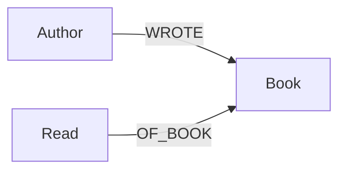

# Schema

## Phase 1 — core

### `Author`
| Property | Type   | Notes |
|----------|--------|-------|
| `name`   | string | Unique. Normalize spelling/format before load (see ingest notes). |
| `wikidata_id` | string | Optional accepted Wikidata entity reference. |
| `wikidata_status` | string | `matched`, `not_found`, `ambiguous`, or `error`. |
| `wikidata_checked_at` | datetime | Last lookup attempt. |

### `Book`
| Property | Type   | Notes |
|----------|--------|-------|
| `books_id` | string | Stable unique ID from the cumulative CSV; preserves leading zeros. |
| `title`  | string | Display title; not an identity key. |
| `wikidata_id` | string | Optional accepted Wikidata entity reference. |
| `openlibrary_id` | string | Optional work ID used for summary fallback; not a local identity key. |
| `publication_year` | integer | From Wikidata, or Open Library when Wikidata has no year. |
| `summary` | string | Open Library work description only; Wikidata descriptions are not treated as summaries. |
| `summary_source` | string | Provenance for the stored summary. |
| `wikidata_status` | string | `matched`, `not_found`, `ambiguous`, or `error`. |
| `wikidata_checked_at` | datetime | Last lookup attempt. |

### `Read`
| Property   | Type         | Notes |
|------------|--------------|-------|
| `date`     | Neo4j `Date` | Built from `year_month`, day defaults to `01`. |
| `score`    | float        | Decimal ratings are retained without imposing a score range. |
| `books_id` | string       | Stable unique source ID; enforces one Read per Book. |

### Why a `Read` node instead of a relationship property?

Two options were on the table:

- `(Author)-[:WROTE]->(Book)` and score/date as properties on a
  `(:Author)-[:READ {date, score}]->(Book)` relationship, **or**
- a dedicated `Read` node.

The `Read` node wins for a few reasons:
1. A dedicated node keeps date and score together as a reading event. The
   current CSV and unique `Read.books_id` constraint allow one event per
   book; a future re-read model would add a separate read ID.
2. It's the natural place to later attach things like "mood when reading"
   or "format (ebook/physical)" without touching `Book` or `Author`.
3. Querying "what did I read in the same period as book X" is a clean
   `Read`-to-`Read` date comparison rather than reasoning about
   relationship properties across different relationship types.

## Phase 2 — enrichment

### New/changed nodes

| Label     | Properties | Notes |
|-----------|------------|-------|
| `Book`    | `+ summary`, `+ publication_year` | Wikidata is primary; Open Library is used only as a summary/year fallback. |
| `Gender`  | `name` (unique) | Node rather than a property — see rationale below. |
| `Genre`   | `name` (unique) | Node, not a property, because books can have multiple genres and you'll want to aggregate/traverse by genre (e.g. for similarity). |
| `Country` | `name` (unique) | Node linked with `CITIZEN_OF`; Wikidata P27 is citizenship, not necessarily nationality. |

### Design principle used throughout

Every enrichment fact — genre, citizenship, gender — is something you
want to **group, count, and aggregate by** for the bias check and
recommendations ("what % of books I've read are by women," "which
countries am I underrepresenting"). That's the actual shared property
across all three, so all three are modeled as nodes rather than scalar
properties: `(:Author)-[:HAS_GENDER]->(:Gender {name})`,
`(:Author)-[:CITIZEN_OF]->(:Country {name})`,
`(:Book)-[:HAS_GENRE]->(:Genre {name})`.

Wikidata P21 (sex or gender) and P27 (country of citizenship) point to
entities, not literal strings. The graph preserves those entities and
does not relabel citizenship as nationality.

A fact stays a plain **property** when it's inherently singular and
has no substructure worth attaching to later — `Read.score`, `Read.date`,
`Book.summary`. There's nothing to aggregate "by score" in the same
sense; score is the thing being aggregated, not a grouping key.

## Constraints

See `constraints.cypher`. Identity constraints are on `Book.books_id` and
`Read.books_id`; names remain unique for authors and enrichment nodes.
External IDs are stored as references, not local identity keys, because
different local records can resolve to the same Wikidata work/person.

## Open modeling questions for later

- Re-reads are not represented: the source has one row and one `Read` per
   `books_id`. A future re-read model would need a separate stable read ID.
- `books_id` is the source identity. Do not reuse or regenerate an ID for a
   different book. Titles may repeat without merging distinct books.

## Ingestion and enrichment behavior

The single CSV in `data/raw/` is cumulative and append-only. It has the
columns `books_id,title,author,year_month,score`. Ingestion validates the
whole file before connecting to Neo4j, preserves IDs as strings, accepts
finite decimal scores, and splits author names on `/`. Re-running the same
file is idempotent: Books and Reads are merged by `books_id`, and Authors
and relationships are merged by normalized name.

Start with a fresh database and apply the constraints before the first load.
Every source row must have a stable `books_id`; ingestion does not migrate
Books or Reads from an older title-keyed schema. The source CSV splits authors
with `/`, and ingestion creates one Author node and `WROTE` relationship per name.

Wikidata is the primary enrichment source. Only one exact-label candidate
of the expected entity type is auto-accepted; ambiguous and missing matches
are written to a review CSV under `data/reports/`. Accepted Wikidata IDs
are reused on refresh. New and unresolved entities are checked each run;
accepted matches are refreshed after 180 days or with `--refresh`. Lookup
errors do not erase previously stored facts. Author P27 is modeled as
`CITIZEN_OF`, not nationality. Open Library is queried only when a book has
no stored summary; a summary is saved only for one exact title-and-author
work match, with `summary_source` recorded. Wikidata descriptions are not
misrepresented as book summaries.
