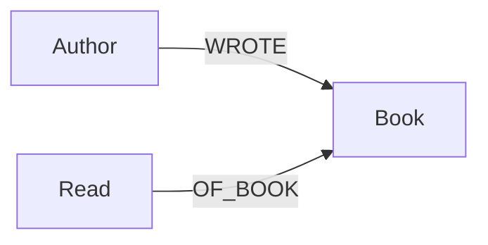
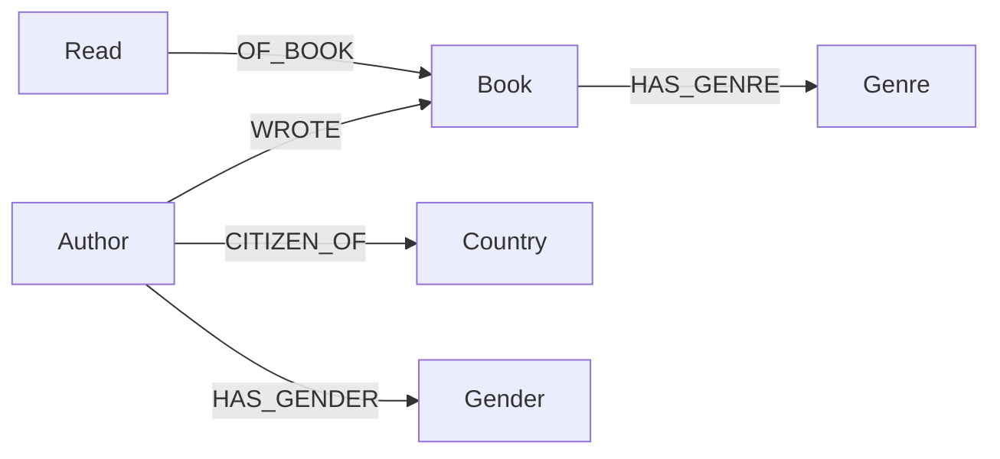

# Schema

## Phase 1 - core

### `Author`
| Property | Type   | Notes |
|----------|--------|-------|
| `name`   | string | Unique. Normalize spelling/format before load (see ingest notes). |
| `wikidata_id` | string | Optional accepted Wikidata entity reference. |
| `wikidata_status` | string | `matched`, `needs_review`, `no_candidate`, or `error`. `no_candidate` means the attempted search found no verified human candidate; it does not prove absence from Wikidata. |
| `wikidata_checked_at` | datetime | Last lookup attempt. |

### `Book`
| Property | Type   | Notes |
|----------|--------|-------|
| `book_id` | string | Stable unique ID from the cumulative CSV; preserves leading zeros. |
| `title`  | string | Display title; not an identity key. |
| `wikidata_id` | string | Optional accepted Wikidata entity reference. |
| `openlibrary_id` | string | Optional work ID used for summary fallback; not a local identity key. |
| `publication_year` | integer | From Wikidata, or Open Library when Wikidata has no year. |
| `publication_year_source` | string | `wikidata` or `openlibrary`; records provenance for safe replacement. |
| `summary` | string | Open Library work description only; Wikidata descriptions are not treated as summaries. |
| `summary_source` | string | Provenance for the stored summary. |
| `openlibrary_status` | string | `matched`, `ambiguous`, `not_found`, or `error`; separate from Wikidata status. |
| `openlibrary_checked_at` | datetime | Last Open Library summary lookup. |
| `wikidata_status` | string | `matched`, `needs_review`, `no_candidate`, or `error`. `no_candidate` means the attempted search found no book passing its type and known-author checks; it does not prove absence from Wikidata. |
| `wikidata_checked_at` | datetime | Last lookup attempt. |

### `Read`
| Property   | Type         | Notes |
|------------|--------------|-------|
| `date`     | Neo4j `Date` | Built from `year_month`, day defaults to `01`. |
| `score`    | float        | Decimal ratings are retained without imposing a score range. |
| `title_read` | string     | Title as encountered while reading; distinct from the canonical `Book.title`. |
| `language_read` | string  | Language of the reading, copied from the CSV after trimming surrounding whitespace. |
| `book_id` | string       | Stable unique source ID; enforces one Read per Book. |

### Why a `Read` node instead of a relationship property?

Two options were on the table:

- `(Author)-[:WROTE]->(Book)` and score/date as properties on a
  `(:Author)-[:READ {date, score}]->(Book)` relationship, **or**
- a dedicated `Read` node.

The `Read` node wins for a few reasons:
1. A dedicated node keeps date and score together as a reading event. The
   current CSV and unique `Read.book_id` constraint allow one event per
   book; a future re-read model would add a separate read ID.
2. It's the natural place to later attach things like "mood when reading"
   or "format (ebook/physical)" without touching `Book` or `Author`.
3. Querying "what did I read in the same period as book X" is a clean
   `Read`-to-`Read` date comparison rather than reasoning about
   relationship properties across different relationship types.

## Phase 2 - enrichment

### New/changed nodes

| Label     | Properties | Notes |
|-----------|------------|-------|
| `Book`    | `+ summary`, `+ publication_year` | Wikidata is primary; Open Library is used only as a summary/year fallback. |
| `Gender`  | `name` (unique) | Node rather than a property - see rationale below. |
| `Genre`   | `name` (unique) | Node, not a property, because books can have multiple genres and you'll want to aggregate/traverse by genre (e.g. for similarity). |
| `Country` | `name` (unique) | Node linked with `CITIZEN_OF`; Wikidata P27 is citizenship, not necessarily nationality. |

### Design principle used throughout

Every enrichment fact - genre, citizenship, gender - is something you want to **group, count, and aggregate by** for the bias check and recommendations ("what % of books I've read are by women," "which countries am I underrepresenting"). That's the actual shared property across all three, so all three are modeled as nodes rather than scalar properties: `(:Author)-[:HAS_GENDER]->(:Gender {name})`, `(:Author)-[:CITIZEN_OF]->(:Country {name})`, `(:Book)-[:HAS_GENRE]->(:Genre {name})`.

Wikidata P21 (sex or gender) and P27 (country of citizenship) point to entities, not literal strings. The graph preserves those entities and does not relabel citizenship as nationality.

A fact stays a plain **property** when it's inherently singular and has no substructure worth attaching to later - `Read.score`, `Read.date`, `Read.title_read`, `Read.language_read`, and `Book.summary`. A scalar property can still be useful as an aggregation key, as with counting reads by `language_read`.

## Constraints

See `constraints.cypher`. Identity constraints are on `Book.book_id` and `Read.book_id`; names remain unique for authors and enrichment nodes. External IDs are stored as references, not local identity keys, because different local records can resolve to the same Wikidata work/person.

## Open modeling questions for later

- Re-reads are not represented: the source has one row and one `Read` per
   `book_id`. A future re-read model would need a separate stable read ID.
- `book_id` is the source identity. Do not reuse or regenerate an ID for a
   different book. Titles may repeat without merging distinct books.

## Ingestion

The append-only CSV selected by `BOOKS_CSV_PATH` contains
`book_id,title,title_read,language_read,author,year_month,score`. The loader
stores `title_read`, `language_read`, `date`, and `score` on `Read`; it stores
the canonical title on `Book` and creates one `Author`/`WROTE` relationship
per slash-separated author. IDs are preserved as strings. Each CSV row must
have a stable unique `book_id`; the loader does not migrate data from an older
title-keyed graph. See the [user guide](../docs/user-guide.md) for CSV
validation and correction instructions.

## Enrichment Provenance

Wikidata IDs are external references, not local identity keys. Wikidata P21
and P27 facts are modeled as `HAS_GENDER` and `CITIZEN_OF` relationships;
genre facts are `HAS_GENRE` relationships. Open Library summary and publication
year values carry their own source metadata, independently from Wikidata
matching. Wikidata descriptions are not stored as book summaries. Operational
statuses, retries, and correction procedures are documented in the
[user guide](../docs/user-guide.md).
