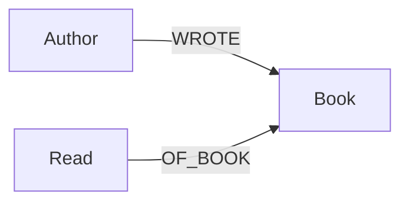
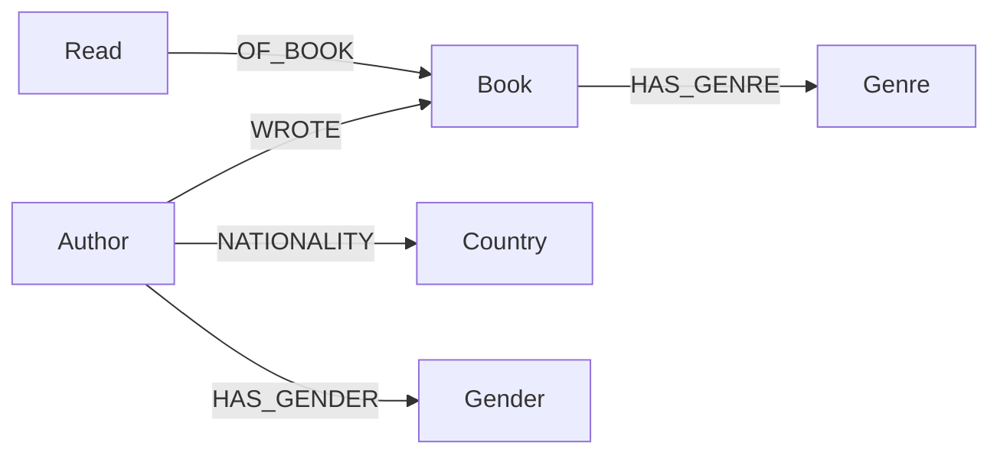

# Schema

## Phase 1 — core

### `Author`
| Property | Type   | Notes |
|----------|--------|-------|
| `name`   | string | Unique. Normalize spelling/format before load (see ingest notes). |

### `Book`
| Property | Type   | Notes |
|----------|--------|-------|
| `title`  | string | Unique for now — assumes no two books in your library share a title. |

### `Read`
| Property | Type         | Notes |
|----------|--------------|-------|
| `date`   | Neo4j `Date` | Built from `year_month`, day defaults to `01`. |
| `score`  | integer      | Your rating. |

### Why a `Read` node instead of a relationship property?

Two options were on the table:

- `(Author)-[:WROTE]->(Book)` and score/date as properties on a
  `(:Author)-[:READ {date, score}]->(Book)` relationship, **or**
- a dedicated `Read` node.

The `Read` node wins for a few reasons:
1. You said re-reads aren't a priority now, but a relationship property
   can't cleanly hold two different dates/scores for the same
   Author–Book pair — a node can (multiple `Read` nodes pointing at the
   same `Book`). Cheap future-proofing.
2. It's the natural place to later attach things like "mood when reading"
   or "format (ebook/physical)" without touching `Book` or `Author`.
3. Querying "what did I read in the same period as book X" is a clean
   `Read`-to-`Read` date comparison rather than reasoning about
   relationship properties across different relationship types.

## Phase 2 — enrichment

### New/changed nodes

| Label     | Properties | Notes |
|-----------|------------|-------|
| `Book`    | `+ summary`, `+ publication_year` | From Open Library / Google Books / Wikidata. |
| `Gender`  | `name` (unique) | Node rather than a property — see rationale below. |
| `Genre`   | `name` (unique) | Node, not a property, because books can have multiple genres and you'll want to aggregate/traverse by genre (e.g. for similarity). |
| `Country` | `name` (unique) | Node rather than a property on `Author`, so you can aggregate reads-by-nationality for the bias check, and so one `Country` can later gain its own properties (region, etc.) if useful. |

### Design principle used throughout

Every enrichment fact — genre, nationality, gender — is something you
want to **group, count, and aggregate by** for the bias check and
recommendations ("what % of books I've read are by women," "which
countries am I underrepresenting"). That's the actual shared property
across all three, so all three are modeled as nodes rather than scalar
properties: `(:Author)-[:HAS_GENDER]->(:Gender {name})`,
`(:Author)-[:NATIONALITY]->(:Country {name})`,
`(:Book)-[:HAS_GENRE]->(:Genre {name})`.

This also mirrors how Wikidata itself models these facts — `P21`
(sex/gender) and `P27` (country of citizenship) both point to *entities*,
not literal strings — so pulling enrichment data in stays a direct
mapping rather than a flattening step.

A fact stays a plain **property** when it's inherently singular and
has no substructure worth attaching to later — `Read.score`, `Read.date`,
`Book.summary`. There's nothing to aggregate "by score" in the same
sense; score is the thing being aggregated, not a grouping key.

## Constraints

See `constraints.cypher`. Uniqueness constraints on `Author.name`,
`Book.title`, `Genre.name`, and `Country.name` double as indexes, which
matters once you start running the analytics queries.

## Open modeling questions for later

- If you ever *do* want to track re-reads, nothing changes — you'd just
  allow multiple `Read` nodes per `Book` per `Author`, which the schema
  already supports.
- If titles turn out not to be unique in your library, switch the `Book`
  key to a composite of `title + author` or bring in an external ID
  (ISBN/Open Library ID) once you enrich.
